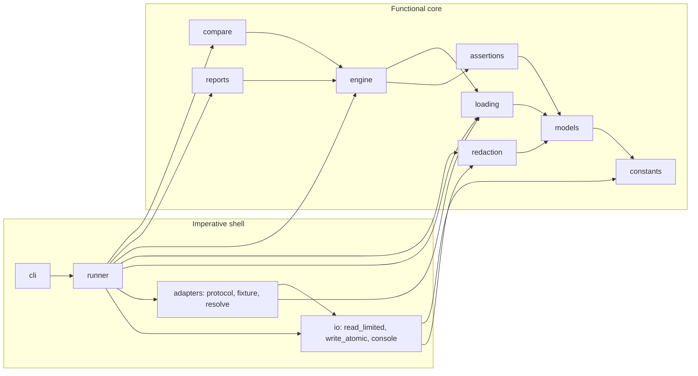
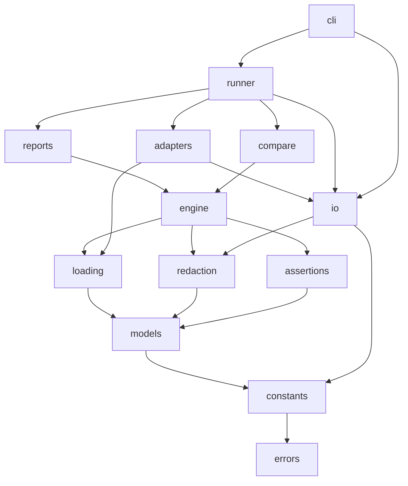
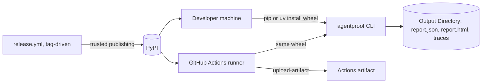

# Architecture Spine — AgentProof v0.1

Rationale for every decision is in `adr-log.md` (one ADR per AD) and `.memlog.md`. `[ASSUMPTION]` marks a default chosen without the maintainer; `[ADOPTED]` marks a decision the spec, the PRD, or the user's instruction had already settled; the Open Decisions table at the end names what must be settled before coding. In every diagram an arrow `A --> B` means "A may import B".

## Design Paradigm

**Functional core, imperative shell**, with hexagonal ports at the two edges where the world enters: agents (Adapter port) and the filesystem and terminal (artifact and console ports).

- **Core** (`constants`, `models`, `loading`, `redaction`, `assertions`, `engine`, `reports`, `compare`): pure functions over frozen Pydantic models. No clock, no environment, no filesystem, no network, no randomness, no threads. Same inputs, same bytes out.
- **Shell** (`adapters`, `runner`, `io`, `cli`): the only code that calls an Adapter, reads or writes files, reads environment variables, generates ids or timestamps, or prints. It feeds the core and persists what the core returns.
- **Ports**: `Adapter` (driven port: the Fixture Agent and future framework adapters implement it) and `io` (artifact store and console). The CLI is a thin driving adapter over `runner` and the public API.



## Invariants & Rules

### AD-1 — Pure core, effectful shell

- **Binds:** all
- **Prevents:** evaluation results that depend on the machine, the clock, or the order of side effects; adapters or renderers that quietly change status; a second file reader or writer appearing inside the core.
- **Rule:** No module under `constants`, `models`, `loading`, `redaction`, `assertions`, `engine`, `reports`, or `compare` may call `open`, `pathlib.Path` I/O methods, `os.environ`, `os.stat`, `time`, `datetime.now`, `uuid`, `random`, `socket`, `subprocess`, `threading`, or `asyncio`, nor import any name from `agentproof.io`, `agentproof.runner`, `agentproof.adapters`, or `agentproof.cli`. Core functions receive text, bytes, or models and return models, text, or bytes. The shell generates every run id and timestamp and passes them in. Enforced by an import-linter `forbidden` contract for the package names and a ruff `flake8-tidy-imports` banned-API list for the stdlib names, both run by the single check entry point (AD-17).

### AD-2 — Dependency direction

- **Binds:** all
- **Prevents:** circular imports; framework SDKs leaking into core; two modules each believing it may build or write the same artifact.
- **Rule:** The `.importlinter` layer contract is the authority and is reproduced here exactly. Higher layers may import lower ones; siblings (`|`) may not import each other.

  ```
  cli
  runner
  reports | compare
  engine
  loading | redaction | assertions
  models
  constants
  errors
  ```

  Outside the layer stack: `io` may import `errors`, `constants`, `redaction` (for `scrub_text`) and nothing else from the package; `adapters` may import `errors`, `constants`, `models`, `loading`, `io`; `runner` may import `adapters` and `io`; `cli` may import `runner` and `io`. Nothing imports `cli`. No module imports a framework SDK except an adapter module under `adapters/`, installed as an optional extra.

  The same file carries `forbidden` contracts for the modules outside the stack: `io` may import only `errors`, `constants`, `redaction`; `adapters` only `errors`, `constants`, `models`, `loading`, `io`; `testing` only `models`, `loading`, `adapters`, `errors`; `cli` only `runner`, `io`, and the public API (AD-15). The layer contract alone would let `cli` import core modules directly; the forbidden contract closes that.



### AD-3 — Frozen, forbid-unknown models with integer schema versions

- **Binds:** `models`, every serialized artifact (Suite, Trace, Report)
- **Prevents:** a writer adding a field an older reader silently ignores; two readers disagreeing on what a version means; the same bytes validating differently through two entry points.
- **Rule:** Every serialized model is `BaseModel` with `model_config = ConfigDict(frozen=True, extra="forbid")`. `strict` mode is not used; instead every model is validated only through the single `loading.parse_*` function for its kind, which always goes `text/bytes → json.loads or yaml_safe.load → model_validate(dict)`, so Python-mode validation is the only mode in use. Timestamps are `str` fields validated by `constants.RFC3339_WITH_OFFSET` and stored exactly as given (no normalization). Each artifact carries `version: int`. `constants.SUPPORTED_VERSIONS = {"suite": (1,), "trace": (1,), "report": (1,)}` is the only place a reader learns what it accepts; any other version raises `UnsupportedVersionError` (exit 2). Adding or renaming a field in a serialized model is a new integer version plus a new fixture under `tests/fixtures/schema/`. `[ASSUMPTION: integer, not the spec example's string "1"; strings are rejected]`

### AD-4 — JSON Schemas are generated, never hand-edited

- **Binds:** `schemas/`, `models`
- **Prevents:** the published schema and the Pydantic model drifting apart.
- **Rule:** `schemas/suite-v1.schema.json`, `schemas/trace-v1.schema.json`, `schemas/report-v1.schema.json` are produced by `python -m agentproof_devtools.export_schemas` (a devtools script that writes the text of the pure `agentproof.models.export_schemas.render`) from `model_json_schema()` (JSON Schema 2020-12) and committed. A test regenerates them and fails on any diff. Consumers on other stacks validate against these files; the Python package validates with Pydantic and never imports `jsonschema` at runtime.

### AD-5 — Trace event addressing and Final Output

- **Binds:** `models.trace`, `assertions`, `reports`, `compare`
- **Prevents:** evidence pointing at different events in different artifacts; two assertions disagreeing on what "final output" is.
- **Rule:** `TraceEvent.seq` is a 0-based contiguous integer; `parse_trace` rejects gaps, duplicates, and disorder. Evidence is `list[int]` of `seq` values and nothing else. Final Output is `output: JsonValue | None` on the `agent_finished` event; the last `agent_finished` event is the one used. `tool_call` carries `tool.name` and optional `tool.call_id`; `tool_result` links by `call_id` when present, by nearest preceding `tool_call` otherwise. `Trace.capture` is a required model with default `Capture(tool_calls="unknown")`, so every Trace object, whatever its path in, carries a value and no shell step is needed. `[ASSUMPTION: contiguous seq is stricter than AC-7.2's ascending rule]`

### AD-6 — One status fold, one exit-code module, skip and absence decided in core

- **Binds:** `engine`, `cli.exit_codes`, `compare`, `runner`, `adapters`
- **Prevents:** the public API and the CLI reporting different results for the same inputs; two places computing a Suite Status or an Exit Code; adapter failures aborting a Suite or hiding as evaluation errors.
- **Rule:** `engine.evaluate_scenario(scenario, trace: Trace | None, defaults: SuiteDefaults, *, execution_error: str | None = None) -> ScenarioResult` is the only place `skip`, an absent Trace, and an adapter failure are interpreted, in this precedence and always by fan-out to one Assertion Result per Assertion: (1) a `skip` reason yields `skipped` results carrying the reason and nothing else is consulted; (2) `execution_error` yields `error` results carrying the message and sets `ScenarioResult.execution_error`; (3) `trace is None` with `defaults.fail_on_missing_trace` true yields `error` results and sets `ScenarioResult.execution_error = "trace missing"`, with it false yields `skipped` results; (4) otherwise every Assertion is evaluated. The runner never calls an adapter for a skipped Scenario. A Scenario has at least one Assertion (schema rule), so `combine` never sees an empty list. `engine.status.combine(statuses)` is the only fold, at scenario and suite level: `failed` if any `failed`; else `error` if any `error`; else `skipped` if all `skipped`; else `passed`. `engine.fold(results: list[ScenarioResult]) -> SuiteOutcome` is the only constructor of `SuiteOutcome` and derives `suite_status`, `execution_failed = any(r.execution_error is not None)`, and `evaluated_assertions` (results whose status is not `skipped`); `evaluate_suite` and the runner both end in `fold`. The runner catches `TraceMissingError` from an adapter and calls the engine with `trace=None`; it catches every other `Exception` from `Adapter.run`, wraps it as `AdapterRunError`, calls the engine with `execution_error`, and continues with the next Scenario. `cli.exit_codes` exposes exactly `from_outcome(outcome: SuiteOutcome) -> int` and `from_comparison(comparison: Comparison) -> int`; `cli/app.py` holds the only `typer.Exit` and `sys.exit` sites (a grep test enforces this). `from_outcome` returns 3 if `outcome.execution_failed`, else 1 if the Suite Status is `failed` or `error` or `outcome.evaluated_assertions == 0`, else 0; `cli/app.py` maps `InputError` to 2 before calling it and any other escaped exception to 4 after it.

### AD-7 — Error taxonomy

- **Binds:** `errors`, every module that raises
- **Prevents:** stack traces for user mistakes; execution failures masquerading as assertion errors or vice versa.
- **Rule:** `errors.py` is the only module that defines exception classes. All derive from `AgentProofError`. `InputError` (`SuiteError`, `TraceFormatError`, `PathError`, `UnsupportedVersionError`) means the user's input is wrong and maps to exit 2 with no traceback; it carries `violations: list[Violation(source, field, message)]` and the CLI prints one line per violation. `ExecutionError` (`AdapterLoadError`, `AdapterRunError`, `TraceMissingError`, `ArtifactWriteError`) means the run could not produce or persist evidence and maps to exit 3. A Trace named on the command line that fails to parse is input (exit 2); a Trace read on behalf of an adapter during `run` that fails to parse is wrapped as `AdapterRunError` (exit 3). An exception raised inside an assertion's `evaluate` is caught by the engine and becomes an `AssertionResult` with status `error` and message `<ExceptionType>: <message>`, never propagated. Anything else reaches the last-resort handler in `cli/app.py` and exits 4.

### AD-8 — Assertion protocol, registry, and the one YAML shape

- **Binds:** `assertions`, `models.suite`, `loading.suite`, docs and the `init` template
- **Prevents:** an unregistered or unvalidated assertion reaching evaluation; two YAML spellings for one assertion; two builders assigning assertion ids differently.
- **Rule:** Configuration and evaluation are split across the layer boundary so `models` never imports `assertions`. `models.assertions` defines one frozen config model per type with `type: Literal["<name>"]` and the static union `AssertionConfig = Annotated[Union[ToolCalled, ToolNotCalled, ToolCallCount, ToolArgumentsMatch, ToolOrder, FinalOutputContains], Field(discriminator="type")]`; `models.suite.Scenario.assertions: list[AssertionConfig]` with `min_length=1`, so an unknown `type` fails at parse with the Scenario id and field path. `assertions/builtin/<type>.py` defines the pure `evaluate(config, trace) -> AssertionResult` for one type; `assertions.registry.EVALUATORS: dict[str, Evaluator]` maps type name to evaluator and a test asserts its keys equal the union's `type` literals. The engine looks up the evaluator by `config.type`. The only YAML form is the flat mapping with a `type` key (`- type: tool_not_called` / `tool: approve_expense`); no shorthand keys. `tool_call_count` takes exactly one of the sibling keys `equals`, `greater_than`, `less_than`, enforced by a model validator. `assertion.id` defaults to `<type>-<0-based index in the scenario list>` and is assigned by a `models.suite` validator, so the API and the CLI see the same ids. Adding an assertion is one config model, one evaluator module, one registry line, and tests for pass, fail, invalid configuration, and missing evidence.

### AD-9 — Adapter protocol and the runner as sole owner of run identity

- **Binds:** `adapters`, `runner`, `models.trace`
- **Prevents:** an adapter bypassing validation or redaction, computing status, choosing run ids or timestamps, or being imported by core.
- **Rule:**
  ```python
  class Adapter(Protocol):
      name: str
      version: str
      def run(self, scenario: Scenario, context: RunContext) -> Trace: ...

  @dataclass(frozen=True)
  class RunContext:
      run_id: str
      started_at: str
      suite_dir: Path
      output_dir: Path
      deterministic: bool
      logger: logging.Logger
  ```
  `Adapter` and `RunContext` live in `adapters/protocol.py`. The runner resolves an adapter by name (`fixture` is built in; otherwise the `agentproof.adapters` entry-point group; otherwise a `pkg.module:ClassName` string imported directly, `[ASSUMPTION: the dotted form exists so own-agent users need no packaging]`), generates `run_id` and `started_at`, and after `run` returns overwrites `run_id`, `started_at`, `ended_at`, and `environment` with its own values (`model_copy(update=...)`) and only then re-validates through `loading.parse_trace`, so adapters may fill those four fields with any placeholder; whatever they put there is discarded. `environment` is filled only by the runner from the allowlist `Environment(package_version, python_version, os, source_revision)`; nothing reads `os.environ` into it. With `deterministic=True` (from `defaults.fixture.deterministic`) the runner sets `run_id = "fixture-<scenario id>"` and copies `started_at`/`ended_at` from the fixture Trace file instead of the clock. An adapter that cannot produce a Trace for a Scenario raises `TraceMissingError` (the Fixture Agent does so when `scenario.trace` is absent or missing on disk); the Fixture Agent resolves `scenario.trace` against `context.suite_dir` and reads it through `io.read_limited`. Adapters are synchronous; an adapter may create its own event loop with `asyncio.run` because the runner never holds one. `agentproof.testing.adapter_conformance.check(adapter, suite)` ships in the wheel as the generic conformance suite (AC-21.5) and is public API. `[ASSUMPTION: sync-only in v0.1]`

### AD-10 — Redaction at ingress, one rule set, one marker, one scrubber

- **Binds:** `redaction`, `runner`, `io.console`, `models.trace`
- **Prevents:** evaluation, terminal output, and artifacts seeing different data; two scrub implementations; replay forgetting what a previous run redacted.
- **Rule:** `redaction.redact(trace, rules, secret_values) -> Trace` and `redaction.scrub_text(text, secret_values) -> str` are the only two redaction functions; `io.console` uses `scrub_text` for every printed or logged line. `RedactionRules` = default keys (`api_key`, `token`, `password`, `authorization`, matched case-insensitively at any depth of `arguments`, `result`, `metadata`, `output`; `redact.keys` extends this set and cannot remove from it) + user dotted paths; `secret_values` are the current values of `redact.env` names, resolved by the runner (never by core), scrubbed longest first; an empty or unset variable contributes nothing. The marker is `constants.REDACTED = "[REDACTED]"`. `Trace.redaction` is `RedactionState(applied: bool, paths: list[str], env_names: list[str])` where `paths` are the configured rule strings that matched; `redact` is idempotent and merges: it unions `paths` and `env_names` with whatever the incoming Trace already records and never un-marks a `redacted: true` event. Public-API equivalence (AC-19.2, AC-34.2) is defined as `evaluate_scenario(scenario, redact_trace(trace, rules, secret_values), defaults)`; calling the engine on an unredacted Trace is allowed and documented as outside the equivalence. Whether very short declared values are scrubbed is ARCH-6.

### AD-11 — Canonical form, compact form, and volatile paths

- **Binds:** `models.canonical`, every artifact writer, `assertions`, `compare`, golden tests
- **Prevents:** byte-level diffs caused by platform, key order, or encoding; comparison flapping on timestamps; assertions and reports serializing the same value differently.
- **Rule:** `models.canonical` (bottom of the core, importable by assertions) exposes `dumps(obj) -> str` (`json.dumps(sort_keys=True, indent=2, ensure_ascii=False) + "\n"`) for artifacts and `dumps_compact(obj) -> str` (`separators=(",", ":")`, sorted keys, `ensure_ascii=False`) for matching; `final_output_contains` matches structured output against `dumps_compact`. Artifacts are written as UTF-8 without BOM with `newline="\n"`; every file is opened with explicit `encoding="utf-8"`. `models.canonical.VOLATILE_PATHS` is the one list, expressed as path patterns (`run_id`, `created_at`, `package_version`, `scenarios[*].trace.run_id`, `scenarios[*].trace.started_at`, `scenarios[*].trace.ended_at`, `scenarios[*].trace.environment`, `scenarios[*].trace.events[*].timestamp`, `scenarios[*].trace.events[*].duration_ms`, `scenarios[*].cost`), that `compare` excludes and golden tests strip, so the same Suite run on Linux and Windows CI produces equal stripped Reports; nothing matches by bare key name. NaN and infinity are rejected by the models. `[ASSUMPTION: compact form for matching; PRD AC-16.2 says "Canonical form text" and should read "compact Canonical form"]`

### AD-12 — Safe HTML rendering

- **Binds:** `reports.html`
- **Prevents:** trace content executing or linking in a report.
- **Rule:** `reports.html.render(report) -> str` assembles the page from stdlib string templates; every dynamic value passes `html.escape(value, quote=True)` and lands only as element text or inside a double-quoted attribute. No value is placed in `<title>`, `<style>`, `<script>`, an unquoted attribute, or an `href`/`src`. No JavaScript, no embedded JSON, no external resources; the page carries `<meta http-equiv="Content-Security-Policy" content="default-src 'none'; style-src 'unsafe-inline'">`. Events render inside `<details>` elements: every event referenced by any Evidence index is always rendered expanded; of the remaining events, the first 500 per scenario render collapsed and the rest collapse to a count and the JSON path as text. No Jinja2 in v0.1.

### AD-13 — One pipeline, one Report builder, one writer

- **Binds:** `runner`, `reports`, `io.artifacts`, `cli`
- **Prevents:** `run` and `trace replay` diverging; the Report being constructed in two places; a second non-atomic writer.
- **Rule:** `runner.run_suite(suite, *, adapter, output_dir, clock, env) -> SuiteOutcome` and `runner.replay(suite, scenario_id, trace_bytes, *, output_dir, env) -> SuiteOutcome` share one private pipeline: resolve `secret_values` from `defaults.redact.env` and install the console scrub → obtain a Trace (`adapter.run` or `loading.parse_trace`) → `redaction.redact` → `engine.evaluate_scenario` → `engine.fold` → `reports.build_report` → `io.write_atomic`. For `run`, the pipeline also writes each redacted Trace as `scenario-<id>.trace.json` before the Report; `replay` writes only `replay-<id>.report.json` and never touches `scenario-*.trace.json` or `report.json`. `reports.build_report(outcome, *, suite, run_id, created_at, package_version, traces: Mapping[str, Trace | None]) -> Report` is the only constructor of `Report` and copies `suite.defaults` into `Report.defaults` as a `SuiteDefaults` value; `reports.json_report.dumps(report) -> str`, `reports.html.render(report) -> str`, and `compare.dumps(comparison) -> str` return text only; `io.artifacts.write_atomic(path, data: bytes)` is the only function that writes a file. The CLI commands `run` and `trace replay` call `runner`; `report` and `compare` call `load_report`, `render_html`, `dumps_report`, `compare`, and `dumps_comparison` from the public API; no command assembles a Report or imports a core module directly.

### AD-14 — Artifact naming and safe writes

- **Binds:** `io.artifacts`, `io.paths`, `runner`, `cli`, `models.suite`
- **Prevents:** scenario names escaping the Output Directory; truncated or stale files; replay overwriting run output; two copies of the id rule.
- **Rule:** Output Directory defaults to `./agentproof-output/`; `--output` on `run` and `trace replay` names that directory and may be any path. Inside it, names are fixed: `report.json`, `scenario-<id>.trace.json`, `replay-<id>.report.json`; `report --format html` writes the JSON name with `.json` replaced by `.html` next to its input unless `--output FILE` names a file. `constants.SCENARIO_ID_RE` and `constants.WINDOWS_DEVICE_NAMES` are the single definitions; `models.suite` is the only validator (charset, case-insensitive uniqueness, device names) and `io.paths` only asserts the regex when forming a path. `write_atomic` writes to `tempfile.NamedTemporaryFile(dir=target.parent, prefix=".agentproof-", delete=False)` then `os.replace`; failure raises `ArtifactWriteError` (exit 3) naming the target and leaving the temp file. A symlink inside the Output Directory resolving outside it is refused. Atomicity is guaranteed on POSIX and best-effort on Windows.

### AD-15 — Public API surface and the parse/load split

- **Binds:** `agentproof/__init__.py`, docs, semver policy
- **Prevents:** users depending on internals; the CLI and the API diverging; core growing a file reader.
- **Rule:** The public API is exactly `agentproof.__all__`: `parse_suite(text, *, source)`, `parse_trace(data, *, source)`, `parse_report(data, *, source)` (core, no I/O), `load_suite(path)`, `load_trace(path)`, `load_report(path)` (shell: `io.read_limited` then parse), `evaluate_scenario`, `evaluate_suite(suite, traces: Mapping[str, Trace | None]) -> SuiteOutcome` (calls `evaluate_scenario` per Scenario in declared order and ends in `engine.fold`, so an API caller gets the same `SuiteOutcome` the runner produces for the same Traces), `redact_trace`, `run_suite`, `replay`, `compare(baseline: Report, current: Report) -> Comparison`, `render_html(report) -> str`, `dumps_report(report) -> str`, `dumps_comparison(comparison) -> str`, the models `Suite`, `Scenario`, `SuiteDefaults`, `Trace`, `TraceEvent`, `AssertionResult`, `ScenarioResult`, `SuiteOutcome`, `Report`, `Comparison`, the `Adapter` protocol and `RunContext`, `agentproof.testing`, `SUPPORTED_VERSIONS`, `__version__` (read once from `importlib.metadata`; `pyproject.toml` is the single source), and the `errors` module. The CLI imports only these plus `io`; a test asserts it. Subpackages are internal before 1.0 and documented as such; while the package is 0.x, a minor release may change the public API with a changelog entry, and a patch release may not.

### AD-16 — Runtime dependency cap

- **Binds:** `pyproject.toml`
- **Prevents:** dependency creep that forces a vendor or inflates install.
- **Rule:** Runtime dependencies are `pydantic`, `typer`, `rich`, `pyyaml`, with lower bounds pinned and upper bounds on majors. Anything else is a dev dependency or an optional extra (`agentproof[<adapter>]`). Adding a runtime dependency requires an ADR. `jsonschema` is dev-only (AD-4).

### AD-17 — Determinism and security are tests, and one check entry point mirrors CI

- **Binds:** `tests/`, `.github/workflows/ci.yml`, contributor docs
- **Prevents:** "deterministic", "no network", and "no leak" claims that hold only on the author's machine; local and CI checks diverging.
- **Rule:** One entry point (`uv run check`, implemented as a script or a task runner, `[ASSUMPTION: tool open]`) runs in order: `ruff check`, `ruff format --check`, `mypy --strict`, `lint-imports`, `pytest`. CI runs that entry point on `ubuntu-latest` and `windows-latest` across Python 3.12, 3.13, 3.14, 3.15, then builds the wheel, installs it into a clean venv and runs `agentproof version` plus the documented quick-start commands, runs `pip-audit`, and runs the example Suite inside `docker run --network none` from a `run:` step (container-job `--network` options are not supported by Actions). The documented quick-start commands are the fenced blocks in `README.md` and `docs/` tagged `agentproof-doctest`, extracted and executed by `tests/e2e/test_docs.py`, so docs and the executed commands cannot drift. The test suite includes: golden-file tests per artifact kind (LF-protected by `.gitattributes`); a `conftest` guard active for every test that makes `socket.socket` and `subprocess.Popen` raise, disabled only by an explicit `@pytest.mark.allow_subprocess` on the CLI subprocess tests, so `trace replay` and `run --adapter fixture` through the shell are covered; the secret-leak test (AC-28.2, AC-31.3) over every artifact and captured output; the exit-code matrix driving the CLI as a subprocess for codes 0 to 4 (4 through `AGENTPROOF_FAULT_INJECT`, honored only when `AGENTPROOF_TESTING=1`); the schema-drift test (AD-4); the public-API import test (AD-15); the single-exit-site grep (AD-6); and one end-to-end script covering spec §12.4. Actions are pinned by SHA with `permissions: contents: read` by default.

### AD-18 — No services, no database, no telemetry, single process `[ADOPTED]`

- **Binds:** all
- **Prevents:** scope leaking toward the hosted product; concurrency bugs in a tool whose promise is determinism.
- **Rule:** v0.1 has no server process, no database, no message broker, no background workers, no telemetry, and no network call outside an explicitly configured non-fixture adapter. State is files in the Output Directory. The runner executes Scenarios sequentially in declared order in one thread and one process and never creates threads, processes, or event loops. A `storage` abstraction is not scaffolded.

### AD-19 — Safe parsing and input limits

- **Binds:** `loading.yaml_safe`, `loading`, `io.read_limited`, `constants`
- **Prevents:** code execution or resource exhaustion from a Suite or Trace; two loaders with different safety rules.
- **Rule:** `loading.yaml_safe.load(text, *, source)` is the only YAML entry point: a `yaml.SafeLoader` subclass that rejects duplicate mapping keys (naming key and line), rejects aliases and anchors, rejects a second document, and never constructs objects or custom tags. A document may hold at most `constants.MAX_YAML_NODES` nodes, enforced during composition, before any construction. JSON is parsed only by `json.loads`. `exec`, `eval`, `pickle.loads`, `marshal`, and `yaml.load` without the safe loader are banned everywhere — shell packages and devtools included — by the ruff flake8-bandit rules (S102, S307, S301, S302, S506) in AD-1's `select`; the `pickle`, `marshal`, and `shelve` modules are additionally banned in the core packages by AD-1's TID251 list. The only deserializers in the codebase are `loading.yaml_safe.load` and `json.loads`. Size is enforced before parsing by `io.read_limited(path, max_bytes)` with `constants.MAX_SUITE_BYTES = MAX_TRACE_BYTES = MAX_REPORT_BYTES = 5 * 1024 * 1024` `[ASSUMPTION: 5 MB each; OQ-12]`; the limit is a constant, not configuration, in v0.1. Optional fields default to `None`, `null` and absent are equivalent on input, and `canonical.dumps` writes every field (no `exclude_none`) so every artifact of a kind has the same key set. NaN and infinity are rejected on input.

### AD-20 — CLI contract

- **Binds:** `cli`, docs
- **Prevents:** two commands spelling the same option differently; the spec's and the PRD's replay signatures both being implemented.
- **Rule:** Typer app `agentproof` with these exact signatures and no others in v0.1:
  - `init [PATH]` (default `.`); refuses to overwrite; no `--force`.
  - `validate SUITE_PATH`
  - `run SUITE_PATH [--adapter NAME_OR_DOTTED_PATH] [--output DIR]`
  - `trace validate TRACE_PATH`
  - `trace replay TRACE_PATH --suite SUITE_PATH --scenario SCENARIO_ID [--output DIR]` (the spec's `--scenario SCENARIO_PATH` form is not implemented; a missing or unreadable `TRACE_PATH` is a `PathError`, exit 2, because it is a command argument, whereas `fail_on_missing_trace` governs Traces referenced from a Suite or produced by an adapter)
  - `compare BASELINE_REPORT CURRENT_REPORT [--output FILE]` (prints a summary; `--output` writes the `Comparison` as JSON)
  - `report REPORT_PATH --format json|html [--output FILE]` (`junit` is rejected with exit 2 until v0.2)
  - `version`
  Global options: `--verbose`, `--no-color`. Every command prints one summary line per Scenario and a counts line; `InputError` prints one line per violation in the shape of the Error convention. Exit codes come only from AD-6. Fixed user-facing statements (that Comparison is an exact comparison of saved data; that Redaction is key- and declared-value-based; the Capture declaration wording; the §5 limits for the README) live as string constants in `constants.STATEMENTS` and are reused by the CLI, the Report, and the docs, so the claims cannot drift.

## Consistency Conventions

| Concern | Convention |
| --- | --- |
| Naming | Python packages and modules `snake_case`; Pydantic models `PascalCase`; assertion types and event types `snake_case` strings; CLI commands and flags `kebab-case`; artifact files per AD-14. |
| Ids | `scenario.id` per AD-14 charset; `assertion.id` per AD-8; `run_id` per AD-9 (UUID4 from the runner, or `fixture-<scenario id>` when deterministic). |
| Dates | `str`, RFC 3339 with explicit offset, stored as given; `2026-10-22T13:05:00+00:00` and `2026-10-22T13:05:00Z` are both valid and neither is rewritten. Durations are integer milliseconds in `duration_ms`. |
| JSON values | `JsonValue = None | bool | int | float | str | list[JsonValue] | dict[str, JsonValue]`; numbers compare numerically, number and string never match; NaN and infinity rejected. |
| Argument paths | Dotted keys with integer list indexes, `items.0.amount`; no wildcards in v0.1 `[ASSUMPTION: OQ-7]`. |
| Error shape | User-facing: one line per violation, `<kind>: <message> (<source>:<field>)`; `--verbose` appends diagnostics for exit 3 and 4 only. |
| Versioning | Package version from `pyproject.toml` via `importlib.metadata`; 0.x semver with the pre-1.0 policy in AD-15; artifact versions are integers per AD-3 and independent of the package version. |
| Logging | Shell logs through `logging` with the `scrub_text` filter installed by `io.console` before any Trace is read; core never logs. |
| Config | Suite defaults are the only configuration; no config files, no environment-variable substitution; the runner reads `redact.env` names from the environment. |
| Status | `Literal["passed", "failed", "error", "skipped"]`; folded only by `engine.status.combine`. |
| Typing | `mypy --strict` with the pydantic plugin; no `Any` in public signatures; no `from __future__ import annotations` (deferred evaluation is native on 3.14+ and the import is slated for removal) `[ASSUMPTION: mypy over pyright]`. |
| Paths into the core | Core never sees a path; the shell reads with `io.read_limited(path, max_bytes)` (size check before parse, no symlink following outside the Suite directory) and passes text plus a `source` label for error messages. Relative paths in a Suite resolve against the Suite file's directory. |

## Stack

| Name | Version |
| --- | --- |
| Python | >=3.12,<4 (CI: 3.12, 3.13, 3.14, 3.15) |
| uv | 0.13.x |
| pydantic | >=2.14,<3 |
| typer | >=0.27,<1 |
| rich | >=15,<16 |
| PyYAML | >=6.0.3,<7 |
| pytest | >=9.1 |
| hypothesis | >=6.170 |
| ruff | >=0.17 |
| mypy | >=2.4 |
| import-linter | >=2.15 |
| jsonschema (dev) | >=4.26 |
| pytest-cov (dev) | >=7.1 |
| pip-audit (CI) | >=2.10 |
| GitHub Actions | pinned by SHA |

## Structural Seed

### Repository

```text
agentproof/                         # repository root (distribution name: OQ-1)
  AGENTS.md  README.md  LICENSE  CONTRIBUTING.md  SECURITY.md  CODE_OF_CONDUCT.md
  .gitignore  .gitattributes  .editorconfig  .pre-commit-config.yaml  .importlinter
  .github/workflows/ci.yml  release.yml
  schemas/                          # generated JSON Schemas (AD-4)
    suite-v1.schema.json  trace-v1.schema.json  report-v1.schema.json
  examples/expense-agent/           # init template source; runs with the Fixture Agent
    agentproof.yaml  traces/*.trace.json
  docs/                             # getting-started, suite-format, assertions, traces, cli, security
    decisions/                      # ADRs move here from adr-log.md in EPIC A
  packages/python/
    pyproject.toml  uv.lock
    src/agentproof/
      __init__.py                   # public API (AD-15)
      errors.py                     # AD-7
      constants.py                  # SUPPORTED_VERSIONS, SCENARIO_ID_RE, WINDOWS_DEVICE_NAMES, RFC3339_WITH_OFFSET, REDACTED, MAX_*_BYTES, STATEMENTS
      models/                       # common.py (JsonValue, Status), canonical.py, assertions.py (config union), suite.py, trace.py, result.py, report.py, export_schemas.py
      loading/                      # yaml_safe.py (dup keys, no aliases, no multi-doc), suite.py (parse_suite), trace.py (parse_trace), report.py (parse_report)
      redaction/                    # rules.py, apply.py (redact, scrub_text)
      assertions/                   # base.py (Evaluator type), registry.py (EVALUATORS), builtin/{tool_called,tool_not_called,tool_call_count,tool_arguments_match,tool_order,final_output_contains}.py
      testing/                      # adapter_conformance.py (public, ships in the wheel)
      engine/                       # evaluate.py (evaluate_scenario, evaluate_suite), status.py (combine)
      reports/                      # build.py (build_report), json_report.py (dumps), html.py (render)
      compare/                      # compare.py (compare -> Comparison)
      adapters/                     # protocol.py (Adapter, RunContext), fixture.py, resolve.py (entry points)
      runner/                       # pipeline.py (run_suite, replay), clock.py
      io/                           # paths.py, artifacts.py (read_limited, write_atomic), console.py
      cli/                          # app.py (Typer app, error handler, exit sites), exit_codes.py, commands/{init,validate,run,trace,compare,report,version}.py
    tests/
      unit/  integration/  e2e/  golden/  fixtures/schema/v1/
      conftest.py                   # network and subprocess guard, secret fixtures
  packages/viewer/                  # does not exist in v0.1 (FR-35)
```

### Schemas (seed; the Pydantic models own the detail once they exist)

Suite (`version: 1`), YAML:

```yaml
version: 1
suite: expense-agent              # id, same charset as scenario ids
description: "..."                # optional
defaults:                         # all optional
  adapter: fixture                # adapter name; CLI --adapter overrides
  fail_on_missing_trace: true
  fixture: {deterministic: true}  # runner derives run_id and timestamps from the fixture Trace
  compare: {include_arguments: ["approve_expense.amount"]}
  redact: {keys: [], paths: [], env: ["OPENAI_API_KEY"]}
scenarios:
  - id: reject-over-limit
    description: "..."            # optional
    skip: "reason"                # optional; presence means skipped
    input: {expense_amount: 5000} # JsonValue object passed to the adapter
    trace: traces/reject-over-limit.trace.json   # optional; fixture source, and replay default; relative to this file
    assertions:
      - type: tool_not_called
        tool: approve_expense
      - type: tool_call_count
        tool: reject_expense
        equals: 1
      - id: says-rejected        # optional; default tool_called-2 style per AD-8
        type: final_output_contains
        value: "rejected"
        case_sensitive: true
```

Trace (`version: 1`), JSON:

```json
{
  "version": 1,
  "run_id": "fixture-reject-over-limit",
  "scenario_id": "reject-over-limit",
  "started_at": "2026-10-22T13:05:00+00:00",
  "ended_at": "2026-10-22T13:05:02+00:00",
  "agent": {"name": "expense-agent", "version": "1.2.0"},
  "adapter": {"name": "fixture", "version": "0.1.0"},
  "model": {"provider": null, "name": null},
  "capture": {"tool_calls": "complete"},
  "environment": {"package_version": "0.1.0", "python_version": "3.12.15", "os": "Linux", "source_revision": null},
  "redaction": {"applied": true, "paths": ["arguments.api_key"], "env_names": ["OPENAI_API_KEY"]},
  "events": [
    {"seq": 0, "type": "agent_started", "timestamp": "...", "duration_ms": null, "tool": null, "arguments": null, "result": null, "status": null, "error": null, "output": null, "redacted": false, "metadata": {}},
    {"seq": 1, "type": "tool_call", "timestamp": "...", "tool": {"name": "reject_expense", "call_id": "c1"}, "arguments": {"amount": 5000}, "redacted": false, "metadata": {}},
    {"seq": 2, "type": "tool_result", "tool": {"name": "reject_expense", "call_id": "c1"}, "result": {"ok": true}, "status": "ok", "redacted": false, "metadata": {}},
    {"seq": 3, "type": "agent_finished", "output": "Expense rejected: over limit", "redacted": false, "metadata": {}}
  ]
}
```

The events after `seq: 0` are abbreviated above; on disk every event carries the full key set `seq, type, timestamp, duration_ms, tool, arguments, result, status, error, output, redacted, metadata`, with absent optional fields serialized as `null` (AD-19). Event `type` is one of `agent_started`, `agent_finished`, `tool_call`, `tool_result`, `llm_request`, `llm_response`, `exception`, `approval_requested`, `approval_granted`, `approval_denied`, `custom`; `error` is `{"type": str, "message": str, "unhandled": bool} | null`.

Results and Report (`version: 1`), JSON:

```json
{
  "version": 1,
  "suite_id": "expense-agent",
  "run_id": "…",
  "created_at": "…",
  "package_version": "0.1.0",
  "schema_versions": {"suite": 1, "trace": 1},
  "defaults": {"adapter": "fixture", "fail_on_missing_trace": true, "fixture": {"deterministic": true}, "compare": {"include_arguments": []}, "redact": {"keys": [], "paths": [], "env": ["OPENAI_API_KEY"]}},
  "suite_status": "failed",
  "execution_failed": false,
  "counts": {"passed": 2, "failed": 1, "error": 0, "skipped": 0},
  "scenarios": [
    {
      "scenario_id": "reject-over-limit",
      "status": "failed",
      "skip_reason": null,
      "execution_error": null,
      "counts": {"passed": 2, "failed": 1, "error": 0, "skipped": 0},
      "assertions": [
        {"assertion_id": "tool_not_called-0", "type": "tool_not_called", "status": "failed", "message": "approve_expense was called (capture: complete)", "evidence": [1], "detail": {}},
        {"assertion_id": "tool_call_count-1", "type": "tool_call_count", "status": "passed", "message": "reject_expense was called 1 time (equals 1)", "evidence": [1], "detail": {}},
        {"assertion_id": "says-rejected", "type": "final_output_contains", "status": "passed", "message": "final output contains \"rejected\"", "evidence": [3], "detail": {}}
      ],
      "trace": { "…the redacted Trace, or null when absent…" },
      "cost": null
    }
  ]
}
```

`SuiteOutcome` is the in-memory shape `engine.fold` returns (`scenarios: list[ScenarioResult]`, `suite_status`, `execution_failed`, `evaluated_assertions`); `Report` is `SuiteOutcome` plus identity, counts, the Suite defaults snapshot (the `SuiteDefaults` model, serialized with every field), and embedded Traces, built only by `reports.build_report`. A Baseline is a Report file; `compare` takes `include_arguments` from the current Report's `defaults.compare` snapshot, so no Suite is needed at comparison time. `Comparison` lists per-scenario status changes, assertion-id set differences, tool-sequence differences, selected-argument differences, added and removed scenarios, and `regressed: bool`.

### Deployment and environments



One wheel, installed into any supported Python; no daemon, no state outside the Output Directory; the only environments are "developer machine" and "CI runner". Release is tag-driven through `release.yml` with trusted publishing; the PyPI project name is OQ-1.

## Capability → Architecture Map

| Capability | Lives in | Governed by |
| --- | --- | --- |
| FR-1..FR-4 Suite loading and validation | `loading`, `models.suite`, `cli/commands/init,validate` | AD-3, AD-7, AD-8, AD-14, AD-15 |
| FR-5..FR-9 Trace model and I/O | `models.trace`, `loading.trace`, `io.artifacts` | AD-1, AD-3, AD-4, AD-5, AD-11, AD-14 |
| FR-10..FR-17 Assertions | `assertions` | AD-1, AD-7, AD-8, AD-11 |
| FR-18..FR-21 Evaluation, Replay, Fixture, Adapter | `engine`, `runner`, `adapters` | AD-1, AD-6, AD-9, AD-10, AD-13, AD-18 |
| FR-22, FR-23 Reports | `reports` | AD-11, AD-12, AD-13 |
| FR-24 JUnit | deferred | Deferred |
| FR-25..FR-26 Baseline and Comparison | `compare`, `loading.report` | AD-6, AD-11 |
| FR-27..FR-30 CLI | `cli` | AD-6, AD-7, AD-14, AD-15, AD-20 |
| FR-31 Redaction | `redaction`, `io.console` | AD-10 |
| AC-26.6, AC-31.4, AC-33.3, AC-32.3, AC-12.4 honesty statements | `constants.STATEMENTS`, `cli`, `reports`, docs | AD-20 |
| AC-21.5 adapter conformance | `testing.adapter_conformance` | AD-9, AD-15 |
| NFR-2 parsing safety, AC-1.1..1.6, AC-7.3 | `loading.yaml_safe`, `io.read_limited`, `constants` | AD-19 |
| FR-32 GitHub Actions | `.github/workflows`, `examples/` | AD-17, AD-18 |
| FR-33 Docs and examples | `docs/`, `examples/`, README | AD-8 (one YAML form), AD-15, AD-17 |
| FR-34 Public API | `agentproof/__init__.py` | AD-15 |
| FR-35 Viewer | deferred | Deferred |
| NFR-1 Determinism | `models.canonical`, `runner.clock`, tests | AD-1, AD-9, AD-11, AD-17 |
| NFR-2, NFR-3, NFR-4 Security, no network, privacy | `loading.yaml_safe`, `reports.html`, `redaction`, `models.trace.environment`, tests | AD-10, AD-12, AD-17, AD-18 |
| NFR-5 Size and robustness | `io.read_limited`, `constants`, tests | AD-7, AD-14, AD-17, AD-19 |
| NFR-6 Portability | CI matrix, `.gitattributes` | AD-17 |
| NFR-7 Install footprint | `pyproject.toml` | AD-16, AD-18 |
| NFR-8 Contract stability | `constants.SUPPORTED_VERSIONS`, `schemas/`, `loading.report` | AD-3, AD-4, AD-15 |
| NFR-9 Test discipline | `tests/`, CI | AD-17 |
| NFR-10 Performance | `engine`, `reports.html` | AD-12 (collapse rule); bound measured in EPIC F |

## Deferred

- **Viewer (FR-35)**: no `packages/viewer`, no root JS tooling until v0.3; the Report schema (AD-3, AD-4) is its contract.
- **Additional assertions** (`final_output_matches`, `final_output_json_schema`, and the rest): v0.2. The regex engine and `$ref` policy (PRD OQ-11) are decided then; AD-8 fixes the protocol they plug into.
- **Framework adapters**: the protocol (AD-9) and entry-point mechanism are fixed; which framework, and its optional extra, wait for PRD OQ-15.
- **Schema version bumps**: v0.1 has one version per kind. The rule when a bump happens is already fixed so it cannot diverge: `loading.parse_<kind>` dispatches on the `version` integer to `models.<kind>.v<N>` and returns the latest model through an `upgrade` function; `compare` and `reports.html` accept only the latest; `SUPPORTED_VERSIONS` lists what dispatch supports. Writing the first `upgrade` waits for the first bump.
- **OpenTelemetry GenAI / OpenInference import mapping** (PRD OQ-18): native schema now; a `trace import --from otel` command can be added without changing AD-5 if span attributes map onto events.
- **Storage abstraction**: not scaffolded (AD-18); a `storage/` package is a v0.5 decision.
- **JUnit XML** (FR-24): v0.2; one more renderer under `reports` returning text, governed by AD-11 and AD-13.
- **Scenario selection and tags on `run`**: v0.2 CLI surface; no AD needed.
- **Performance bound (NFR-10)**: measured in EPIC F on the CI runner; the collapse rule in AD-12 is the only structural commitment.
- **Check task runner** (`poe`, `nox`, or a script): any works; AD-17 fixes only that one entry point exists and CI calls it.
- **Docs tooling** (MkDocs or plain Markdown): v0.1 ships Markdown under `docs/`; a site generator is a launch-prep decision.

## Open Decisions (settle before coding)

| Id | Decision | Blocks | Default assumed here |
| --- | --- | --- | --- |
| OQ-1 | Distribution and import name (PyPI `agentproof` is taken) | `pyproject.toml`, README, FR-32 | import name `agentproof`; distribution name open |
| OQ-2 | License | `LICENSE`, classifiers | Apache-2.0 candidate, unconfirmed |
| OQ-3 | Exit-code precedence and the exit-3 trade-off | AD-6 | PRD AC-27.3/27.4 as written |
| OQ-5 | `version` as integer; timestamps as validated strings; Final Output on `agent_finished` | AD-3, AD-5 | as stated in AD-3, AD-5 |
| OQ-7 | Argument path syntax | conventions, FR-14 | dotted keys with list indexes |
| OQ-9 | Structured Final Output matched against compact Canonical form | AD-11, PRD AC-16.2 wording | compact form |
| OQ-12 | Input size limits | AD-19 | 5 MB per Suite, Trace, Report file |
| OQ-4 | Replay command name | AD-20 | `trace replay` kept, adopted as the PRD default |
| OQ-16 | Output Directory default | AD-14 | `./agentproof-output/`, adopted as the PRD default |
| OQ-13 | Minimum Python | Stack | 3.12 (now security-only upstream; 3.14 is the current bugfix line) |
| OQ-18 | OTel mapping | Deferred | native schema |
| ARCH-1 | mypy or pyright | conventions, AD-17 | mypy |
| ARCH-2 | Sync-only adapter protocol | AD-9 | sync |
| ARCH-3 | Contiguous `seq` versus ascending-only | AD-5 | contiguous |
| ARCH-4 | Check task runner | AD-17 | open; any single entry point |
| ARCH-5 | `defaults.fixture.deterministic` and `scenario.trace` as the Fixture Agent's Suite surface | AD-9, Suite schema | as seeded |
| ARCH-6 | Minimum length below which a declared `redact.env` value is not scrubbed (a PIN-length secret leaks if a floor exists; a 1-character value would corrupt every artifact if none does) | AD-10, PRD FR-31 | no floor; scrub every non-empty value, document the risk |
| ARCH-7 | `--adapter pkg.module:ClassName` direct-import form alongside entry points | AD-9, AD-20 | supported |
